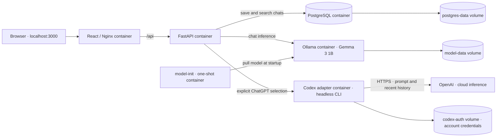

# Local Chat Lab

A Docker Compose demo with a React chat UI, searchable PostgreSQL history, and a
choice of local Ollama or cloud inference through headless Codex. Local is the
default; cloud mode uses ChatGPT sign-in without an OpenAI API key.

## Get started

Install Git and Docker Desktop, then start Docker Desktop. No host Node.js,
Python, or Ollama installation is needed to run the app.

1. [Fork this repository](https://github.com/grantbn8/applied-ai-lab-docker-demo/fork)
   if you want to make changes in your own account.
2. Open Terminal (macOS/Linux) or **Git Bash** (Windows). Replace `YOUR_USERNAME`:

   ```sh
   git clone https://github.com/YOUR_USERNAME/applied-ai-lab-docker-demo.git
   cd applied-ai-lab-docker-demo
   bash scripts/install-hooks.sh
   ```

   Docker must be running for the hooks. Git does not install them automatically.
   Check `git remote -v`: `origin` should point to your fork. For read-only use,
   clone `https://github.com/grantbn8/applied-ai-lab-docker-demo.git` instead.
3. Run from the repository root, where `compose.yaml` lives:

   ```sh
   cp .env.example .env
   docker compose up --build -d
   ```

   Copy `.env.example` only on first setup; preserve an existing `.env`.
4. Open **http://localhost:3000**. API docs: **http://localhost:8000/docs**.

Allow several GB of disk/memory and a few minutes for the first download.
`docker compose logs -f model-init` shows model setup; an exit code of 0 is normal
for this one-shot container. Retry failed downloads with `docker compose up -d`.
CPU replies can be slow, particularly on Docker Desktop for macOS.
See [model notes](model/README.md) for model selection and licensing.

## Architecture



Five long-running services and one initialization job. Only the frontend and API
publish ports, both on localhost. The diagram is maintained with architecture
changes, as required by [AGENTS.md](AGENTS.md).

## Local and cloud chat

Select **Local · Ollama** or **Cloud · ChatGPT** before sending. Replies retain
provider labels. Search matches text in saved titles and messages; history survives
container restarts. Assistant replies support Markdown, and failed requests restore
your draft without saving a partial exchange.

Cloud mode sends your prompt and up to 20 recent conversation messages to OpenAI,
including earlier local messages. Start a new conversation to keep existing local
history out of cloud requests. There is no automatic provider fallback. This is a
single-user demo with shared history and no app authentication; keep it on localhost.

### ChatGPT sign-in

Local mode needs no account. Cloud mode requires a separate sign-in **inside the
container**, even if you already use the Codex desktop app.

1. With the app running, execute from the repository root:

   ```sh
   docker compose exec codex codex login --device-auth
   ```

2. Keep the terminal open. Open the URL it prints, sign into your ChatGPT account,
   enter the displayed device code, and finish authorization. Never commit or share
   the code or credentials. Wait for the terminal to confirm success.
3. Verify:

   ```sh
   docker compose exec codex codex login status
   ```

   It should report ChatGPT authentication. Do not use `--with-api-key`.
4. In the UI, select **Cloud · ChatGPT → Refresh status**. Once it shows
   **ChatGPT signed in · No API key**, send a message.

If login fails, confirm device-code authentication is allowed by your account or
workspace. Expired codes require rerunning the login command. If the service is
stopped, run `docker compose up -d`. Expired credentials, network errors, or account
usage limits can prevent replies; reauthenticate or select Local mode.

The `codex-auth` volume preserves sign-in across restarts. Each user signs in
independently; never share this volume. Cloud requests use the account's Codex
allowance, not API-key billing. The adapter uses the CLI's default model, disables
web search and shell execution, and runs with a read-only sandbox. To sign out:

```sh
docker compose exec codex codex logout
```

## Manage the demo

Run all commands from this repository's root:

```sh
docker compose ps -a                  # Service status
docker compose logs -f backend        # API logs
docker compose up --build -d          # Rebuild after changes
docker compose down                  # Stop; retain data and sign-in
```

To **permanently delete only this demo's containers and volumes**:

```sh
docker compose down --volumes --remove-orphans
```

This deletes its chat history, model weights, and ChatGPT credentials. The next
startup downloads the model again and cloud mode needs a new sign-in. Source files
and images remain. Use the same Compose project name (`-p`, if specified) that you
used at startup. Other projects must have distinct project names.

## Development and verification

- `frontend/`: React UI, API client, and Nginx proxy.
- `backend/app/`: API routes, persistence, and provider routing.
- `backend/migrations/`: idempotent database upgrades applied at startup.
- `codex-service/main.py`: headless Codex adapter and command settings.
- `compose.yaml`: services, health checks, and volumes.
- [AGENTS.md](AGENTS.md): modularity, documentation, and security guidance.

```sh
docker compose config --quiet
curl --fail http://localhost:8000/api/health
python3 scripts/smoke_test.py
```

The optional smoke test needs host Python, calls the local model twice, and leaves
a test conversation. Verify follow-ups, history search, and persistence after a
restart when changing chat behavior. Live cloud verification requires personal
sign-in; CI uses mocked inference and never receives account credentials.

CI requires frontend builds, Python and PostgreSQL integration tests, container
builds, secret scans, and dependency vulnerability audits. Integration tests refuse
databases whose names do not end in `_test`; never use your normal chat database.
See [VULNERABILITY_REMEDIATION.md](VULNERABILITY_REMEDIATION.md) for audit coverage
and fixes. Dependency scans do not cover container OS packages or bundled binaries.

## Security and contributions

Never commit `.env`, tokens, private keys, authentication files, or volume exports.
The database password in `.env.example` is a public local-demo default, not a real
credential. Hooks scan staged files and outgoing history; GitHub push protection
and CI add further checks. Stop on findings or scanner failures; never bypass them.
If a real credential is exposed, revoke/rotate it—deleting the file is insufficient.

```sh
bash scripts/security-check.sh staged
bash scripts/security-check.sh history
```

Only the owner writes upstream; work in your own fork. Forks do not inherit branch
protection or security settings. Upstream CI runs on `main`/`dev` pushes and
manual/release requests, not outside PRs or fork activity. Issues, Discussions,
and wiki are disabled.

The owner pushes to `dev`, opens a PR into `main`, waits for `ci-success`, and
merges with a merge commit. Both branches block force pushes and deletion; `main`
also requires an up-to-date PR and resolved conversations. After merging:

```sh
git fetch origin
git switch dev
git merge --ff-only origin/main
git push origin dev
```

For a release, use **Actions → Release → Run workflow** on `main` with a new
version tag. The owner-only workflow retests the exact commit before publishing.

Code: [MIT license](LICENSE). Model weights have their own [license](model/README.md).
