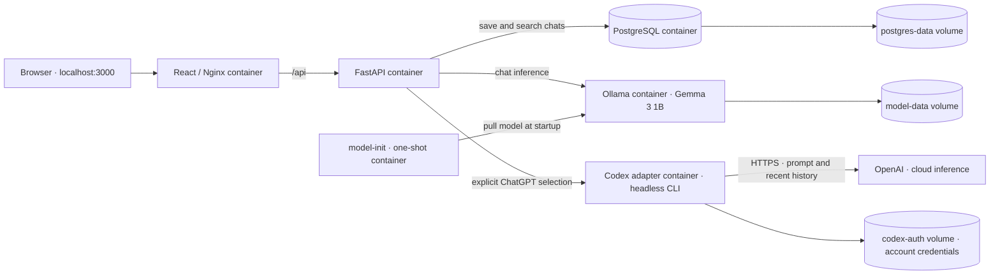

# Local Chat Lab

A small classroom repository for learning Docker Compose and `AGENTS.md` through
an application: switch between a local open-weight model and cloud inference via
headless Codex with ChatGPT sign-in, then search and reopen saved conversations.
No OpenAI API key is required. Local is the default; cloud use is explicit.

## Get your own copy onto your computer

Upstream: **https://github.com/grantbn8/applied-ai-lab-docker-demo**

1. Install Git and Docker Desktop. Start Docker Desktop and wait until it is ready.
2. Sign into GitHub, open the upstream link above, and click **Fork → Create fork**.
   Keep the default repository name. This creates a repository owned by **you**.
3. Open Terminal (macOS/Linux) or **Git Bash** (included with Git for Windows).
   Navigate to the folder where you keep class projects. Replace `YOUR_USERNAME`
   below with your GitHub username:

   ```sh
   git clone https://github.com/YOUR_USERNAME/applied-ai-lab-docker-demo.git
   cd applied-ai-lab-docker-demo
   bash scripts/install-hooks.sh
   ```

   Docker must be running for hook installation and later commits/pushes. The
   installer configures this clone to scan staged files and outgoing Git history.
   Git does **not** install repository hooks automatically. Do not skip this step.

4. Confirm where your pushes will go:

   ```sh
   git remote -v
   ```

   `origin` must show **your fork**, not `grantbn8`. You can edit and push to your
   own fork; public access to the instructor's repository does not grant push access.

5. Open the folder in your editor or Codex and follow [Run](#run). Run all Compose
   commands from this folder, which contains `compose.yaml`.

For read-only exploration, you can clone the instructor's URL directly instead.
For an independent student remote, use the fork steps above. Branch protections
and GitHub security settings are not automatically inherited by forks; configure
those on your own repository if desired. Local hooks are installed per clone.

You do not need host Python, Node.js, or Ollama to run the app. Docker builds and
runs them. Cloud mode additionally requires your own [ChatGPT sign-in](#one-time-chatgpt-sign-in).
The code is available under the [MIT license](LICENSE); model weights have their
own license, linked in [model notes](model/README.md).

## Architecture



Five long-running services and one initialization job. The browser uses a
same-origin Nginx proxy; only the frontend and backend publish ports, bound to
localhost. Compose's service names provide internal DNS. The diagram is maintained
alongside architecture changes, as required by [AGENTS.md](AGENTS.md).

## Run

Prerequisite: Docker with Docker Compose (Docker Desktop is sufficient). Allow
several GB of free disk and memory for the images and model. First startup requires
internet access and can take several minutes to download images and weights.

```sh
cp .env.example .env
docker compose up --build -d
```

Open **http://localhost:3000**. API documentation: **http://localhost:8000/docs**.
The backend waits for PostgreSQL and the model download; the frontend waits for
the backend. To watch first-time setup:

```sh
docker compose logs -f model-init
docker compose ps -a
```

An exited `model-init` container with exit code 0 is expected. If the download
fails, retry with `docker compose up -d`. The default model is
[Gemma 3 1B](https://ollama.com/library/gemma3:1b); see [model notes](model/README.md)
for model selection and licensing. CPU inference can be slow, especially on Docker
Desktop for macOS. The first response may take longer while weights load.

## What to try

1. Ask “Explain Docker volumes in two sentences.”
2. Ask a follow-up in the same conversation.
3. Start a new conversation and ask a different question.
4. Search a word from the first chat and reopen it.
5. Run `docker compose down`, then `docker compose up -d`. History is still there.

Search is case-insensitive literal substring matching across titles and all saved
messages, returning matching conversations. It is deliberately simple SQL search,
not semantic/vector search. Titles come from each conversation's first message.
The last 20 messages are supplied for follow-ups to the selected provider; the local model's 4,096-token context
can further limit how much it sees. All saved messages remain searchable.

Your message appears immediately and the composer clears when you send. Send is
disabled and a spinner appears while the model responds. Assistant replies render
Markdown, including bold text, lists, and code blocks. Failed inference shows an
error, restores the draft for retry, and saves neither half of the failed exchange.
This is a single-user classroom app with shared history and no authentication.

## Repository map

- `frontend/src/main.jsx`: chat UI and history navigation.
- `frontend/src/api.js`: HTTP requests to the backend.
- `frontend/nginx.conf`: static serving and API proxy.
- `backend/app/routes.py`: conversation endpoints and request validation.
- `backend/app/database.py`: PostgreSQL connections and initial schema.
- `backend/app/model.py`: local Ollama integration.
- `backend/app/providers.py`: explicit provider routing and ChatGPT status.
- `codex-service/main.py`: headless Codex adapter using ChatGPT authentication.
- `backend/migrations/`: idempotent SQL upgrades for existing databases.
- `compose.yaml`: services, startup ordering, health checks, and named volumes.
- `AGENTS.md`: lightweight guidance for coding agents working in this repository.

The initial schema is created on startup; idempotent SQL migrations are then
applied in filename order. The provider migration preserves existing messages,
labeling them local. New exchanges record the selected provider.

## Docker classroom commands

```sh
# Validate configuration
 docker compose config --quiet
# Watch backend logs
 docker compose logs -f backend
# Rebuild after editing application code
 docker compose up --build -d
# Open a database shell
 docker compose exec database sh -c 'psql -U "$POSTGRES_USER" -d "$POSTGRES_DB"'
# View downloaded models
 docker compose exec model ollama list
# Stop and remove containers, retaining named volumes
 docker compose down
```

For a deliberate clean reset, `docker compose down -v` **deletes chat history,
model weights, and ChatGPT sign-in credentials**. The next startup downloads the model again.

## Demonstrating AGENTS.md

Ask an agent: “Add a conversation delete button. Follow AGENTS.md and update any
affected documentation.” Review whether it keeps SQL in the backend, uses the
existing request helper, and verifies deletion behavior. Ask for a new service
to demonstrate the architecture-diagram maintenance rule.

## Checks

```sh
docker compose config --quiet
docker compose exec backend python -m compileall -q app
curl --fail http://localhost:8000/api/health
```

The frontend production build runs inside its Docker image. Manually verify a
chat, a follow-up, message-content search, reopening history, and persistence
after a Compose restart. To test failure handling, stop the model with
`docker compose stop model`, send a message, and confirm an error and retained
input; restore it with `docker compose start model`.

For a repeatable API smoke check through the frontend proxy, run
`python3 scripts/smoke_test.py` with the stack running. It calls the actual local
model twice and leaves a small verification conversation in history.


## Local versus cloud classroom demonstration

Use the two buttons above the conversation to select the provider for the next
message. The selection starts on Local whenever the page is loaded. Replies carry
permanent `Ollama · Local` or `ChatGPT · Cloud` labels, including after reopening.
Switching does not send anything by itself. Pressing Send in Cloud mode shares the
new message and up to 20 recent messages from that conversation with OpenAI,
including messages originally written in Local mode. Start a new conversation if
you want to keep an existing local conversation out of cloud requests.

### One-time ChatGPT sign-in

**Local chat works without signing in. Cloud chat requires you to complete the
following steps once on each machine. Signing into the Codex desktop app does not
automatically sign this Docker container in. No OpenAI API key is needed.**

1. Open a terminal in this repository's root directory (the folder containing
   `compose.yaml`). Start the application:

   ```sh
   docker compose up --build -d
   ```

2. In that same terminal, start the container's ChatGPT login:

   ```sh
   docker compose exec codex codex login --device-auth
   ```

3. Keep the terminal open. Codex prints a login URL and a one-time device code.
   Open **the URL printed by Codex** in your browser, sign in to your own ChatGPT
   account, enter the displayed code, and complete the authorization flow. Never
   paste your password or device code into this chatbot or commit it to Git.

4. Return to the terminal and wait for Codex to confirm successful login. Then
   verify it:

   ```sh
   docker compose exec codex codex login status
   ```

   This should report that you are logged in using ChatGPT. If it says you are
   not logged in, repeat steps 2–3. Do not use `--with-api-key` for this demo.

5. Open **http://localhost:3000**, select **Cloud · ChatGPT**, and click
   **Refresh status**. Look for **ChatGPT signed in · No API key**. Type a short
   question and press Send. Its answer should be labeled **ChatGPT · Cloud**.
   This request sends the new message and recent conversation history to OpenAI.

6. Select **Local · Ollama** and send another question to compare local inference.
   Its answer should be labeled **Ollama · Local**. Existing history stays saved
   regardless of the provider selected for the next message.

**If sign-in does not work:**

- Device-code login must be permitted for your ChatGPT account/workspace. If the
  login page asks you to enable device-code authentication, follow that account
  setting; a managed workspace may require its administrator. Use Local mode if
  your account does not permit it.
- A device code can expire. Re-run the login command to get a fresh code.
- If the container is missing or stopped, run `docker compose up --build -d` first.
- If the UI still says sign-in is required, check `codex login status` using the
  command above, then click Refresh status. Logging in on the host is insufficient.
- Stored sign-in does not guarantee available usage. Expired/revoked credentials,
  network errors, or exhausted Codex limits can prevent replies. Reauthenticate
  when needed, check your account limits, or use Local mode. There is no automatic
  fallback and no API key is requested.

To sign out of this demo only:

```sh
docker compose exec codex codex logout
```

The dedicated `codex-auth` volume retains credentials across container recreation.
Do not share that volume or copy credentials into the repository/image. Each
student signs in independently. This is a localhost, single-user teaching demo;
do not expose the account-backed adapter as a public service. Cloud requests use
the signed-in account's Codex allowance and applicable limits, not API-key billing.
The adapter rejects API-key authentication and never falls back to another provider.

Codex runs as a non-root user in a separate container with no source-code, Docker
socket, or database credential mounts. Each reply uses an ephemeral working
directory and read-only Codex sandbox, with shell execution and web search disabled.
PostgreSQL supplies the history; Codex sessions are not reused between conversations.
The CLI version is pinned in its Dockerfile. The adapter has no host-published port.

References: [Headless Codex](https://learn.chatgpt.com/docs/non-interactive-mode)
and [ChatGPT authentication](https://learn.chatgpt.com/docs/auth?surface=cli).

Provider and adapter tests (no cloud sign-in or paid calls required):

```sh
docker compose exec -T backend python - < backend/tests/test_providers.py
docker compose exec -T codex python - < codex-service/tests/test_adapter.py
```

These cover routing without automatic fallback, removal of database metadata from
model payloads, rejection of API-key credentials, and adapter timeout handling.
An actual cloud-response check requires completing the sign-in walkthrough above.


## Maintainer workflow and classroom releases

- `main` is the stable classroom version. It requires a PR, successful `ci-success`,
  an up-to-date branch, and resolved review conversations. No second-person approval
  is required because this repository has one maintainer.
- The owner may push normal commits directly to `dev`. Both branches block force
  pushes and deletion. Students work in their own forks.
- Open a `dev` → `main` PR, wait for CI, and merge using a **merge commit**. Then
  synchronize development with `git fetch origin` followed by
  `git switch dev`, `git merge --ff-only origin/main`, and `git push origin dev`.
- To publish, open **Actions → Classroom release → Run workflow**, select `main`,
  and enter a new version such as `v0.1.0`. Only the repository owner can run a
  successful release. The workflow rechecks the exact commit before creating the
  tag and release. Students can use the release's source archive, but cloning a fork
  is recommended for Git practice.

CI runs frontend builds, Python tests, PostgreSQL integration with mocked model
responses, all three application-image builds, and a full-history secret scan.
The required `ci-success` gate fails if any job fails or is cancelled. CI never
uses a ChatGPT login, calls paid inference, downloads model weights, or deploys a
public chatbot. Cloud generation must be verified locally after personal sign-in.

## Keeping credentials out of Git

Local hooks use Gitleaks v8.30.1 pinned by image digest and block commits/pushes on
findings **or scanner failures**. Docker needs to be running. A separate filename
check blocks `.env`, Codex authentication files, private-key files, and runtime
volume exports. `.env.example` is allowed but still scanned. `classroom-demo` is
an intentionally public local database default, not a real service credential.

```sh
bash scripts/security-check.sh staged   # before a commit
bash scripts/security-check.sh history  # before a push or release
```

GitHub push protection blocks supported credential patterns before accepting a
push; CI scans history again. No detector catches every secret. Never bypass a
failure with `--no-verify`, remove the hooks, or broadly exclude files. Report
redacted filenames only. If a real secret reaches any remote, revoke/rotate it
immediately; merely deleting the current file is not sufficient.

For isolated database integration tests, CI uses a disposable database whose name
ends in `_test`. The tests deliberately refuse other database names and reset only
that test database. Never point them at the database containing your class chats.

## Classroom checkpoint

The November 5, 2026 classroom starting point is release **v0.1.0**. Use its tag
when you need the exact demonstrated version. Normal development continues on
`dev`; tested changes reach `main` through a pull request.


## Student work and upstream notifications

This upstream repository distributes the classroom example. Do your work and run
Actions in **your own fork**; do not open upstream PRs or submit assignments here.
Cloning, forking, and pushes to your fork do not run this upstream's CI.

Upstream CI runs only on main/dev pushes, authorized manual runs, and the release
workflow. It intentionally has no pull-request, issue, comment, or fork trigger.
The owner's dev push supplies the required check for the dev-to-main PR; strict
up-to-date protection remains enabled. Issues, Discussions, and wiki are disabled.

The two failed runs on the initial gate-probe commit were intentional tests of
branch protection, not application regressions. The probe was removed before
v0.1.0, and subsequent CI and release checks passed.

GitHub notifications are a separate personal setting. To silence this repository's
activity, use its **Watch → Ignore** setting (including participation and mentions).
Actions email preferences are under your account's **Settings → Notifications →
System → Actions**; those preferences affect other repositories too. Security and
account emails are separate from classroom activity notifications.
